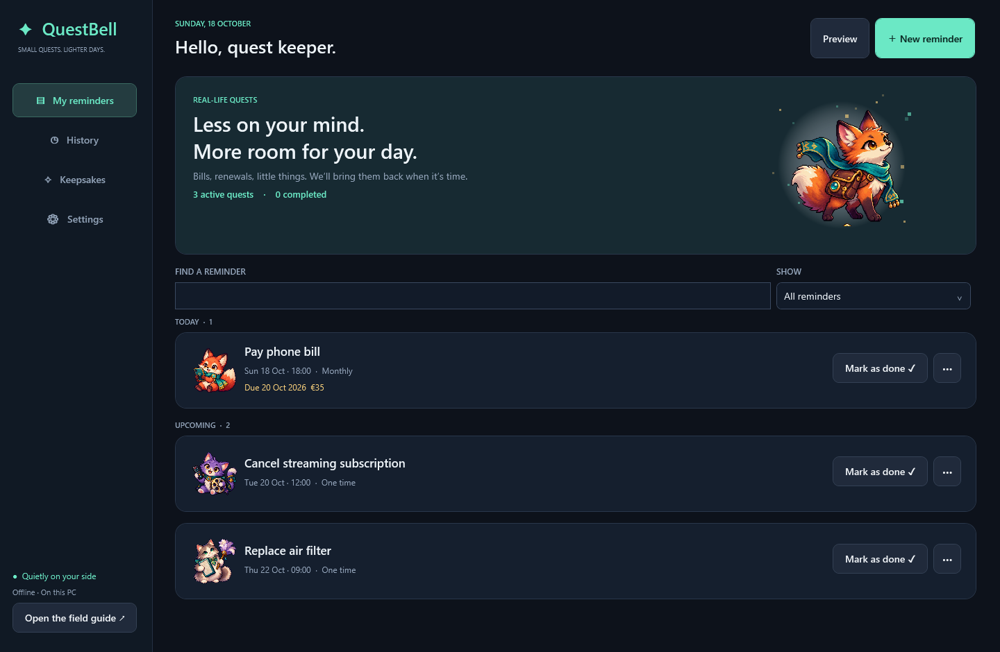

# QuestBell ✦

**Small quests. Lighter days. / Μικρές αποστολές. Πιο ανάλαφρες μέρες.**

A Windows task-reminder app that works offline, with persistent full-screen reminders, a minimal-typing phrase composer, 100 detailed pixel illustrations, English/Greek UI, optional cloud-folder sync and backups, and an illustrated bilingual field guide.

## GitHub updates

QuestBell checks stable releases from **[sidosgr/QuestBell](https://github.com/sidosgr/QuestBell/releases)**. Open **Settings → App updates → Check for updates**. Automatic checks are enabled by default, run shortly after startup when at least 24 hours have passed, and can be turned off. A small in-app banner appears for a newer release; it opens the GitHub release page so you can download and run the installer. No automatic installation or reminder-data upload occurs. Update checks require internet access; reminders work offline.

An unpublished/private repository or one without a stable release shows **No public release is available yet**. Network errors and rate limits show a retry message. Drafts, prereleases and equal/older versions do not prompt an update. Use release tags such as **v1.3.1** and attach the matching installer and checksum. See **[PUBLISHING.md](PUBLISHING.md)** for the release checklist.

## Install and use

Run **[QuestBell-Setup-1.3.1.exe](https://github.com/sidosgr/QuestBell/releases/latest)**. One installer includes the app, the .NET desktop runtime, artwork, sounds, the guide, Start-menu shortcuts, and an uninstaller. Installation is per-user and does not require administrator rights.

- Target: **Windows 10 22H2 or Windows 11, x64**. Earlier Windows builds and 32-bit Windows are not supported by this package.
- The build is unsigned. Windows may display an unknown-publisher/SmartScreen prompt.
- Read the **[illustrated English / Greek guide](docs/index.html)**, also available inside the app through **Open the field guide** and the tray menu.
- This repository also contains the unpacked self-contained app in `artifacts/publish/QuestBell.exe`.



## Optional cloud sync and backups

Both are **off by default**. In **Settings → Cloud sync & backups**, choose a private folder managed by your cloud desktop app, select either or both switches, then Apply choices. QuestBell creates a `QuestBell Cloud` subfolder. On another PC running QuestBell 1.3.1 or later, select that same subfolder after the provider has downloaded it. Mark it available offline (OneDrive: **Always keep on this device**). The app does not sign into a provider itself; your existing cloud client transfers the files.

- Sync merges reminders, completion, snooze, history and custom phrases. Each PC retains its language, monitor, startup, global mute and pause settings. Pinned artwork syncs; automatic artwork rotation stays local.
- Checks run every 30 seconds while the app is running. **Check now** requests a folder exchange. “Folder updated” confirms local file exchange, not remote upload; check your provider's status for cloud delivery. Offline PCs may both notify until changes arrive.
- Each device writes its own file. Record versions and deletion markers merge offline changes deterministically. Simultaneous changes to the same reminder choose one whole version; they are not merged field by field. Device counters and IDs break ties, rather than assuming PC clocks agree.
- Automatic backups preserve the most recent **30 changed snapshots per PC**, also creating a snapshot after reconnect/restart. Independent local recovery copies preserve data before incoming changes, even with cloud backups off. Do not delete device files as a way to remove reminders; delete the reminder in the app.
- **Restore a backup** previews the normal replacement confirmation, preserves a before-import copy and switches both cloud features off. Review the restored data before reconnecting; reconnecting merges/publishes restored changes. **Open recovery copies** gives access to the last 30 local pre-merge copies.
- Files contain readable task details and backups include preferences. Use a private folder. Turning sync off keeps local data and existing cloud files. No cloud-folder access or polling occurs while both switches are off.

The merge and file exchange are tested with isolated folders simulating separate PCs. Provider upload/download and real cross-PC delivery require the user's configured cloud desktop client and have not been tested against a signed-in account here.

## What is included

- **24 dedicated work illustrations**: email inboxes and messenger pets, courier parcels/vans, typewriters and writer pets, newsletter presses/editors, social cameras/creator pets, stationery and office managers. Each of the 26 work templates selects its own related set; custom work titles also recognize common English/Greek topics. Select and pin any named companion in **Review → More options → Artwork & sound**.

- Optional **Work mode**: 26 English/Greek templates for client emails/calls/follow-ups, quotes/invoices/payments, order review/confirmation/packing/shipping/tracking, product and supply orders, stock, suppliers, blog writing/review/publishing, newsletters, social media, weekly content/reporting and meetings/projects.
- Choose **Work** in step 1 or turn on **Settings → Work mode → Start new reminders in Work mode**. Add an optional client/order/product/topic reference; edit the resulting text if needed. **Use this template** rebuilds the title and resets repeat to that template's default, while keeping the selected date/time. Choose shipping dates in step 2. Newsletter, content-plan and weekly-report templates default to weekly; all schedules remain editable.
- Dashboard **All / Work / Personal** filters and work labels distinguish reminders without pausing any of them. Work mode is a local default; work reminders, template references and labels travel with backups/sync. Update every synced PC to **1.3.1 or later** before sharing work reminders: the newer sync format prevents older peers from stripping their work information.

- Build tasks from action + subject + item, or choose one of 25 ready-made templates across seven categories. Add custom phrases and custom titles.
- Create or edit a reminder in three steps: **What → When → Review**. Choose a template, build a phrase or type a custom title; set the time and repeat; then review and create. Timing shortcuts and repeat rules expand under **When**. **Review → More options** holds extra details and artwork/sound. Back/Next and collapsed sections preserve every choice.
- Upcoming reminders use **Mark as done**; full-screen reminders keep the short **Done** and **Snooze** buttons.
- One-time tasks, daily/weekly/monthly/yearly schedules, selected weekdays, interval repeats, and repeat-after-completion.
- Scheduling and snooze presets from five minutes to twelve months, custom intervals, and exact dates/times.
- Optional due date, amount, website link and notes.
- Full-screen Done and Snooze controls, custom snooze, Escape-to-snooze, Skip this time, History and guarded undo.
- Full-screen app deferral: keep waiting for the original full-screen window, even after switching away or minimizing it. Release after it exits full-screen or closes; wait longer if another full-screen app exists.
- Multiple waiting tasks appear oldest first. Repeated missed occurrences of one task are consolidated.
- Primary, selected, or all-monitor display; global/per-task sound; reduced motion; pause/resume; configurable startup.
- Website links temporarily hide the reminder and return after a configurable delay. Links only open http/https websites.
- Automatic subject-matched pixel art, 100 named items and companions, rotation avoiding the last illustration, and pinned favorites.
- Optional keepsakes: one unlock per two completed tasks, no streaks or penalties. Reminder art is always available.
- Local JSON storage with atomic writes, a previous backup, corrupt-file preservation, export and validated import.
- Detailed English/Greek HTML guide with a practice reminder, phrase puzzle, art gallery, scheduling examples, accessibility options, and troubleshooting. All assets work offline.

## Everyday behavior

Closing the management window releases that UI and leaves the tray/scheduler running. **Exit (stops reminders)** in the tray quits the app. Startup with Windows is enabled by default and can be turned off.

The app does not wake a sleeping/off PC. It catches up when running again. Locked sessions defer screens until unlock. Existing full-screen videos/apps are never intentionally interrupted. Reminder visibility and keyboard focus remain subject to Windows; secure desktops and exclusive games need real-device validation.

Done completes the current occurrence and advances a recurring task to the next future slot. A long snooze preserves the original recurrence and does not create duplicate pending occurrences. Monthly dates clamp to shorter months and restore the original day afterwards. Calendar months are not treated as 30-day blocks. Local wall-clock scheduling follows the PC timezone. Spring-forward gaps advance to the first valid minute; an autumn repeated hour has one pending occurrence.

Optional follow-ups are repeating chimes while an unresolved reminder is visible; they never stack duplicate windows. A separate due date is a displayed deadline, not another automatic notification.

## Data and privacy

App data: `%LOCALAPPDATA%\QuestBell\questbell.json`.

No account, telemetry, cloud backend, or network access is required. Clicking a website opens the user's browser. Backups contain readable, unencrypted task details, links, history and preferences. Import replaces current data after confirmation and preserves a before-import copy. Uninstall keeps the data folder.

## Build

Requires a .NET 10 SDK on Windows. No third-party app packages or separate installer framework are required. The app uses C#/WPF; its per-user setup and uninstaller are built with the Windows .NET Framework compiler.

```powershell
./build.ps1 -Dotnet 'C:/path/to/dotnet.exe'
```

If the SDK is installed in `.tools/dotnet`, run `./build.ps1` directly. Output is `artifacts/QuestBell-Setup-1.3.1.exe`; `artifacts/SHA256.txt` records its checksum. The bundled toolchain folder is ignored by Git. The app is self-contained at runtime.

Code-native logo/audio sources: `scripts/create-assets.py` (Pillow needed only to regenerate the icon). Generated artwork and full production prompts: [ARTWORK.md](ARTWORK.md). All 25 transparent atlases live in `src/QuestBell/Assets`; runtime atlas cropping provides 100 illustrations without modifying the source PNGs.

Setup uses the native [Windows Shell Link API](https://learn.microsoft.com/en-us/windows/win32/shell/links) on a dedicated STA thread. It does not require Windows Script Host. Blocked optional shortcuts/settings are logged without aborting a completed app install. The installer offers **View setup details** for notes/failures and writes the full diagnostic log to `%TEMP%\QuestBell-setup.log`.

## Verification

- Core regression suite: `dotnet run --project tests/QuestBell.Tests -c Release`.
- Installer regression suite: `build.ps1` compiles and runs `tests/SetupRegressionTests.cs` against the production installer sources. It creates/reads native shortcuts, uses isolated registry keys/folders, and exercises denied/blocked optional steps and essential failures. Report: `artifacts/setup-regression-report.txt`.
- WPF render/persistence smoke: `QuestBell.exe --render-samples --data-dir <isolated-folder>`; captures dashboard, composer, reminder, settings and collection in both languages without changing startup settings.
- Native full-screen integration: compile `tests/FullscreenFixture.cs` as a Windows Forms executable, then run `QuestBell.exe --integration-test --fixture <fixture.exe> --data-dir <isolated-folder>`. The test fixture opens without activation at the bottom of the window stack.
- Guide checks: `scripts/test-guide.cjs` uses Playwright/Edge, with `QUESTBELL_NODE_MODULES` pointing to the directory containing Playwright.
- Installer smoke: `/silent /no-register /dir=<TEMP>\QuestBell-install-test\<unique-id>\QuestBell` provides an isolated extraction test; uninstaller accepts `/silent /no-register` for that same test install.

Reports and screenshots are in `artifacts`. Validation is on the current Windows host, not a separate Windows 10 machine or every monitor/game configuration. The installer is intentionally unsigned until a release signing certificate is supplied.

## Ελληνικά

Το **QuestBell** θυμίζει λογαριασμούς, συνδρομές, ραντεβού και μικρές εργασίες με εντυπωσιακές εικόνες pixel art. Η υπενθύμιση μένει μέχρι **Έγινε** ή **Αναβολή**, ενώ σέβεται τις εφαρμογές πλήρους οθόνης. Λειτουργεί εκτός σύνδεσης, στην περιοχή ειδοποιήσεων, με ελάχιστη πληκτρολόγηση και προαιρετική επανάληψη.

Εκτέλεσε το `artifacts/QuestBell-Setup-1.3.1.exe`. Διάλεξε **ΕΛ** στην εγκατάσταση ή **Ελληνικά** στις Ρυθμίσεις. Ο αναλυτικός εικονογραφημένος οδηγός ανοίγει μέσα από την εφαρμογή ή από το [docs/index.html](docs/index.html). Η εγκατάσταση περιλαμβάνει ό,τι χρειάζεται και δεν απαιτεί διαχειριστή. Τα δεδομένα μένουν τοπικά και διατηρούνται κατά την απεγκατάσταση.
